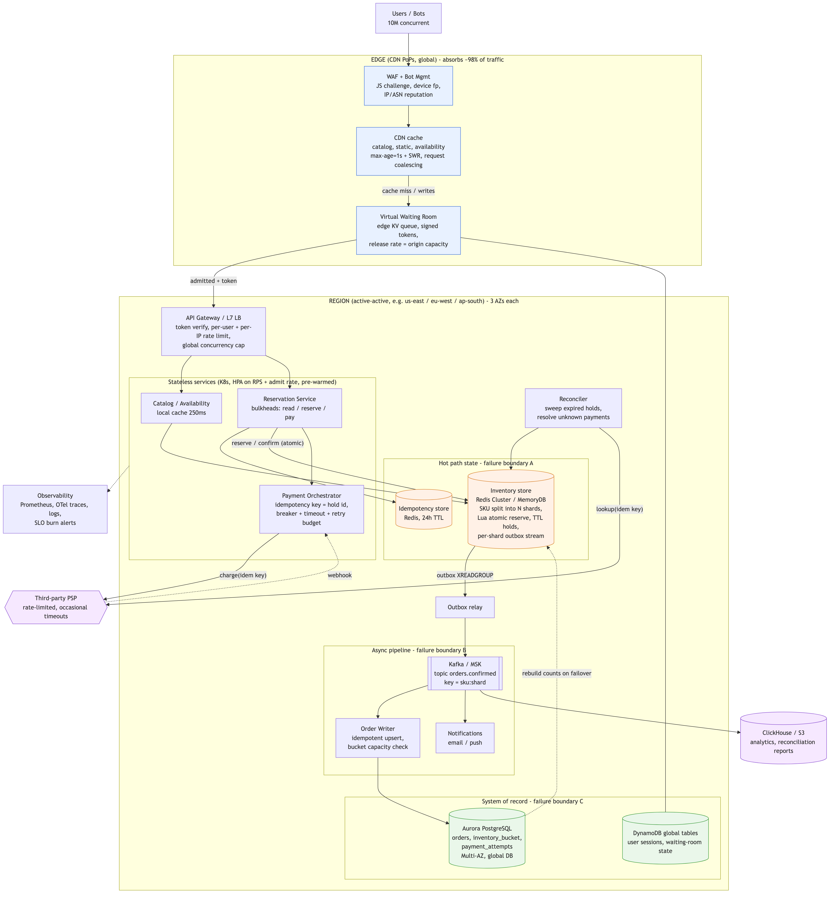

# Diagrams

| Diagram | Source | Export |
|---|---|---|
| High-level design | [`hld.mmd`](hld.mmd) | [`hld.png`](hld.png) |
| Reserve / pay sequence | [`reservation-sequence.mmd`](reservation-sequence.mmd) | [`reservation-sequence.png`](reservation-sequence.png) |

Re-export after editing: `make diagrams` (uses `@mermaid-js/mermaid-cli` via npx).

## HLD walkthrough

**Request flow:** user → WAF/bot management → CDN → virtual waiting room →
(signed admission token) → API gateway → reservation service → Redis
inventory shard → payment orchestrator → PSP → confirm + outbox → Kafka →
order writer → PostgreSQL → notifications.

1. **Edge (blue):** bots are dropped at the WAF. Catalog and availability are
   served from the CDN (1 s TTL, request coalescing). The waiting room holds
   up to 10M users and releases them at the rate origin can serve, issuing
   HMAC-signed tokens. About 98% of traffic never reaches origin.
2. **Gateway and stateless services:** the gateway verifies tokens with no
   I/O and applies per-user and per-IP rate limits. Catalog, reservation and
   payment services autoscale on request rate and admit rate, and are
   pre-warmed for scheduled drops. Each request class has its own bulkhead.
3. **Caches:** CDN (edge), a 250 ms local cache with singleflight
   (availability), and immutable SKU metadata cached in-process.
4. **Hot-path stores (orange), failure boundary A:** inventory is split
   into N Redis/MemoryDB shards per SKU, and every hold transition is one
   atomic Lua script. Idempotency records live in a separate Redis keyspace.
5. **Payment:** the PSP is called with key `charge:<hold_id>` behind a
   timeout, circuit breaker, concurrency limit and retry budget. The
   reconciler sweeps expired holds and resolves unknown payment outcomes.
6. **Queues (async pipeline), failure boundary B:** confirmation writes to a
   per-shard outbox atomically. The relay forwards to Kafka
   (`orders.confirmed`, key `sku:shard`), which feeds the order writer,
   notifications and analytics.
7. **System of record (green), failure boundary C:** Aurora PostgreSQL
   holds orders, payment attempts and inventory buckets with
   `CHECK (sold <= capacity)`. DynamoDB holds sessions and waiting-room state.
   ClickHouse/S3 hold analytics.

**What each failure boundary means:**
- **A (Redis) down:** the affected SKU is paused in the waiting room;
  browsing continues from the CDN.
- **B (Kafka / order writer) down:** selling continues; orders are durable
  in the outbox and catch up later.
- **C (PostgreSQL) down:** selling continues; persistence and order history
  lag.
- **PSP down:** holds stay valid, pay returns 503 with `Retry-After`, and
  nobody is double-charged.

Full detail is in [proposal §2](../proposal.md#2-proposed-architecture).
